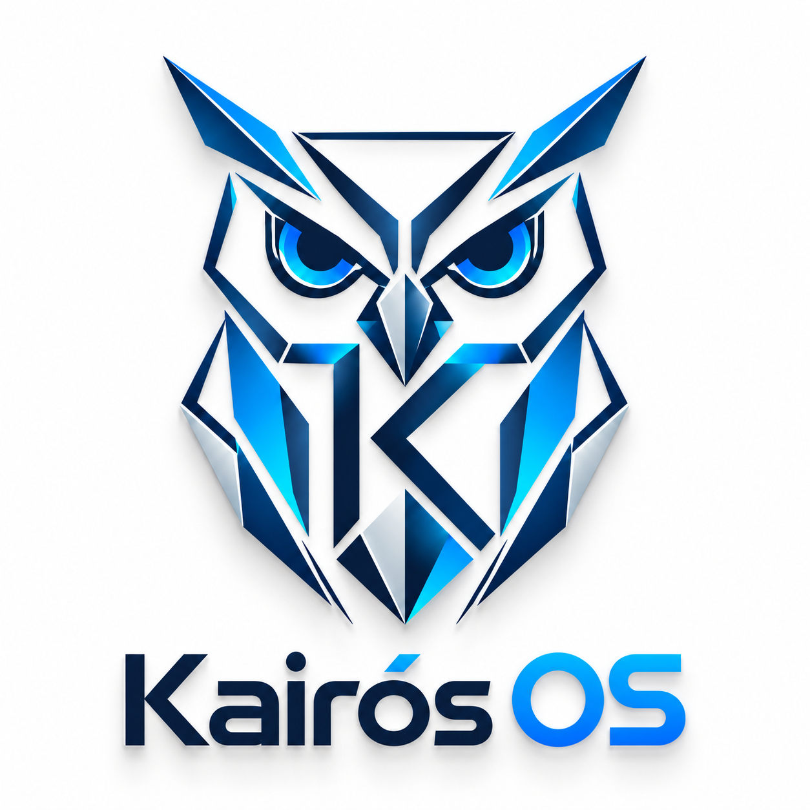

# KAIRÓS OS

{ .kairos-mark }

**Un sistema para aprender cómo funciona un sistema.**

Instalación, consola, escritorio y recursos virtuales en una base modular de HTML, CSS y JavaScript.

[Empezar ahora](guia/inicio.md){ .md-button .md-button--primary }
[Explorar la arquitectura](guia/arquitectura.md){ .md-button }

## Tu recorrido

- **Ejecutar**

    Instala lo necesario y abre el simulador o el escritorio en minutos.

    [Guía de inicio](guia/inicio.md)

- **Entender**

    Recorre los módulos, sus contratos y las fronteras de persistencia.

    [Arquitectura actual](guia/arquitectura.md)

- **Desarrollar**

    Ejecuta pruebas, genera la interfaz y prepara cambios verificables.

    [Desarrollo y pruebas](guia/desarrollo.md)

- **Diseñar el futuro**

    Consulta las decisiones y tareas para evolucionar hacia un entorno Debian.

    [Arquitectura propuesta](ARCHITECTURE_DECISION.md)

!!! info "Estado de la implementación"
    Las aplicaciones actuales son simulaciones funcionales. La sesión Linux, la ISO, las aplicaciones nativas y Kairós AI pertenecen al plan de evolución. Los documentos de esa sección describen propuestas y criterios de aceptación.

## Dos aplicaciones, una identidad

| Aplicación | Entrada | Persistencia |
| --- | --- | --- |
| Simulador y consola | `simulador/index.html` | IndexedDB; volumen privado en Electron |
| Escritorio y aplicaciones | `Interfaz-/index.html` | localStorage independiente |

La [guía de datos](guia/datos.md) explica el alcance del almacenamiento y el cambio de identidad. El [repositorio](https://github.com/Quiroz-Zuniga/KAIROS-OS-) contiene el código, las pruebas y este manual.
